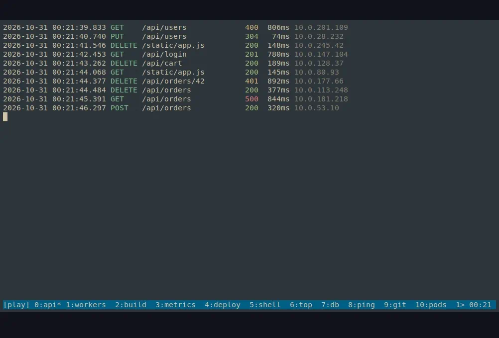

# tmux-session-selector

A replacement for tmux's `prefix` + `w` tree chooser that you filter by typing
plain words or a regular expression, instead of tmux format expressions.



```
> api vim                                         [words]  3/148
──────────────────────────────────────────────────────────────────
 ▾ api  (3 windows, attached)
   ▾ 1: editor
       %4  nvim  ~/www/api
```

One static binary; nothing to install but tmux.

## Install

Download the archive for your system from the
[latest release](https://github.com/mauricioprado00/tmux-session-selector/releases/latest):

```sh
curl -L https://github.com/mauricioprado00/tmux-session-selector/releases/latest/download/tmux-session-selector_linux_amd64.tar.gz \
  | tar -xz -C ~/.local/bin tmux-session-selector
```

Archives exist for `linux_amd64`, `linux_arm64`, `darwin_amd64` and
`darwin_arm64`; `checksums.txt` holds their SHA-256 sums.

Or build and install from a clone with Go 1.22 or newer:

```sh
make install        # into ~/.local/bin
sudo make install   # into /usr/local/bin, for every user
```

`make uninstall` removes it; `BINDIR=…` and `GO=…` override the defaults.

Or with `go install`:

```sh
go install github.com/mauricioprado00/tmux-session-selector/cmd/tmux-session-selector@latest
```

## Bind it

Let the binary do it:

```sh
tmux-session-selector -tmux-bind                  # prefix + w: the selector, replacing tmux's chooser,
                                                  # and prefix + O: the overview, both full screen
tmux-session-selector -tmux-bind -action select   # only one of them (or -action overview)
tmux-session-selector -tmux-bind -key W -overview-key E   # other keys
tmux-session-selector -tmux-bind -open popup      # an 80% popup over the current window
tmux-session-selector -tmux-bind -open window     # a real tmux window (for tmux before 3.2)
tmux-session-selector -tmux-bind -- -normal       # arguments after -- go into the binding
tmux-session-selector -tmux-unbind                # remove both again (or one, with -action)
```

The default, `-open full`, looks like a window of its own but is a popup
covering the whole terminal, so no window is created and none shows in tmux's
status line. With
`-open window` the selector runs in a real, temporary window, which it leaves
out of the list and the overview; the window you came from counts as the
current one.

It writes a marked block to the configuration file tmux reads (the first of
`~/.tmux.conf`, `$XDG_CONFIG_HOME/tmux/tmux.conf`, `~/.config/tmux/tmux.conf`
that exists; `-config PATH` picks another) and applies it to the running tmux
server at once. The binding uses the binary's absolute path, so install it
where it will stay before binding. Unbinding restores what the key did
before, such as tmux's own chooser on `w`.

By hand, the line is (tmux 3.2 or newer):

```tmux
bind w display-popup -E -w 80% -h 80% tmux-session-selector
```

On older tmux, open it in a window instead:

```tmux
bind w new-window -n select tmux-session-selector
```

Reload with `tmux source-file ~/.tmux.conf`.

## Use

Type to filter. `Enter` jumps to the selected session, window or pane; `Esc`
closes without changing anything. The bottom line lists the main keys, with
those of toggles that are on (preview, background processes, titles…) in
green; `?` opens a help panel, which marks them `on` too.

The preview below the list draws the selected window's panes in their real
layout and colours, or a session's windows side by side, like tmux's own
chooser. Unlike tmux's snapshot, it is live: output arriving in a pane shows
while you choose.

With tmux's `mouse` option on, the mouse works too: click selects, double-click
jumps, the wheel moves, and clicking a pane or window in the preview jumps
there; right-click opens a menu of commands, as in tmux. When a session has
more windows than fit, its preview scrolls like
tmux's: click the `<` / `>` arrows or use the wheel over it.

| Query | Shows |
|---|---|
| `api vim` | rows containing both words, in any of session, window, command, path or pane title |
| `!zsh` | rows not containing `zsh` |
| `s:api` | sessions whose name contains `api` (and everything in them) |
| `w:edit` | windows whose name or index contains `edit` |
| `c:vim` | panes running a command containing `vim` |
| `d:www` | panes whose current directory contains `www` |
| `/^api-(dev\|prod)$/` | a regular expression (Go RE2 syntax) |

Matching ignores case unless the query has an uppercase letter. A row shown
dimmed does not match itself; it is there because something inside it does.

Windows show tmux's flags after their name: `*` current, `-` last, `#`
activity, `!` bell (in red), `~` silence, `M` marked pane, `Z` zoomed.

A pane running Claude Code shows its session title, such as
`✳ Fix the login form`, which Claude Code keeps in the pane's title; it comes
with the rest of the list, so it costs nothing, and the search finds it.
The overview shows it too, on the pane's top border. `Ctrl-L` hides or shows
these titles in both the list and the overview, and is remembered. With
them, a pane running an editor (vim, nvim, nano, emacs, helix, micro…) shows
the files it was opened on, and a Claude Code job stopped with `Ctrl-Z` still
shows its session title among the background processes.

`Ctrl-Z` shows each pane's background processes under it, as a tree: jobs
stopped with `Ctrl-Z`, or sent to the background with `bg` or `&`, marked
`stopped` or `running`. `Enter` on one jumps to its pane (then `fg` brings it
back); the search finds them by command. They are read with one `ps` call
when shown, so they cost nothing while hidden. Whether they are shown is
remembered for the next run, as the preview is.

| Key | Action |
|---|---|
| `Up` / `Down`, `Ctrl-P` / `Ctrl-N`, `Ctrl-K` / `Ctrl-J` | move |
| `PgUp` / `PgDn`, `Home` / `End` | move further |
| `Right` / `Tab`, `Left` / `Shift-Tab` | expand, collapse |
| `Backspace`, `Ctrl-W`, `Ctrl-U` | delete a character, a word, everything |
| `Ctrl-R` | switch between words and regex mode |
| `Ctrl-V` | show or hide the pane preview; remembered for next time |
| `Ctrl-Z` | show or hide the panes' background processes (`z` in normal mode) |
| `Ctrl-L` | show or hide Claude Code session titles, here and in the overview; remembered |
| `Ctrl-/` | switch between search and normal mode |
| `Ctrl-O` | overview: every window of the session at once, live |
| `?` (empty query), `F1` | help panel with the query syntax and keys |
| `<` / `>` (empty query) | scroll the windows of a session preview |
| `Enter` | jump |
| `Esc`, `Ctrl-C`, `Ctrl-G` | cancel |

### Two modes

`Ctrl-/` switches between **search mode**, the default, where typing filters,
and **normal mode** (as in vim), where keys are commands, as in tmux's own
chooser: `j`/`k` move, `h`/`l` collapse/expand, `g`/`G` first/last, `0`–`9`
and `M-a`…`M-z` jump to a labelled row, `t`/`T` tag, `x`/`X` kill, `:` runs a
command, `m`/`M` mark, `O`/`r` sort, `H` back to the start pane, `n`/`N` next
match, `v` preview, `/` back to search, `q` quit. Start in normal mode with
`-normal`.

In search mode the same commands are on the letters with **Alt**:

| Key | Action |
|---|---|
| `Alt-0` … `Alt-9` | jump to the row labelled `M-0` … `M-9` on the left |
| `Alt-x` | kill the selected session, window or pane (asks y/n) |
| `Alt-t` / `Alt-T` / `Ctrl-T` | tag or untag the selected row / untag all / tag every match |
| `Alt-m` / `Alt-M` | set / clear tmux's marked pane |
| `Alt-X` | kill the tagged items (or the selected one), asking first |
| `Alt-:` | run a tmux command on each tagged item; `%%` is the target |
| `Alt-o` | sort by index (creation order), name, or time (most recent first) |
| `Alt-r` | reverse the sort |
| `Alt-h` | back to the pane you started from |
| `Alt-+` / `Alt--` | expand / collapse everything |

Command-line flags:

```
tmux-session-selector [flags] [initial query]

  -client NAME   tmux client to switch (default: the calling client)
  -regex         start in regex mode
  -normal        start in normal mode (keys are commands, as in tmux's chooser)
  -no-preview    start with the preview hidden, whatever it was left at
  -refresh DUR   how often the preview updates (default 250ms; 0 for a snapshot);
                 the overview follows panes as they print, unless 0
  -command CMD   run a tmux command on the chosen target instead of switching
                 (the first %% and every %1 become the target)
  -sort ORDER    index (default), name or time
  -reverse       reverse the sort order
  -all-groups    show every session of a session group, not just one
  -overview      open straight into the overview of the current session
  -tmux-bind     bind the selector and the overview in tmux and exit (args after --)
  -tmux-unbind   remove those bindings and exit
  -action WHICH  for -tmux-bind / -tmux-unbind: both (default), select or overview
  -key KEY       the selector's key for -tmux-bind, after tmux's prefix (default w)
  -overview-key KEY  the overview's key for -tmux-bind (default O)
  -open MODE     for -tmux-bind: full (default, whole terminal), popup (80%) or window
  -config PATH   the tmux configuration file for -tmux-bind / -tmux-unbind
  -zoom          zoom the selector's pane while it runs (for a new-window or
                 split binding; has no effect in a popup)
  -version       print the version and exit
```

An initial query gives a pre-filtered view, for example
`bind W display-popup -E "tmux-session-selector s:work"`.

### Overview

`prefix` + `O` (see "Bind it"), `-overview`, or `Ctrl-O` in the list shows every window of the selected session at once, live, for
watching them. From a session row they share the screen evenly; from a window
row that window takes the middle half and the others surround it. Arrows (or
`hjkl`) move the focus, wrapping at the edges; `Tab` steps through the windows
in order and typing a window's number focuses it; `/` searches the panes, as
the list's query does, dimming those that do not match, with `Tab` /
`Shift-Tab` or the arrows going through the matching windows and `Esc` or
`Enter` ending the search; `d` shows each pane's working directory on its
bottom border (remembered); `o` puts the window in focus in the centre (again on
the centred one to share the screen evenly), `+` / `-` grow or shrink the
window in focus and `=` gives it its share back (`=` `=` gives every window
its share back): grown far enough it takes
the empty cell next to it and the windows after it move along, and in a full
grid it widens its row and column instead (a window has one size in the grid
or ring and another in the centre, both remembered between runs),
`i` types into the window's active pane (**type mode**: the pane is framed in
red and shows its cursor, and tmux's prefix then `Esc`, or `Ctrl-]`, stops;
the prefix twice sends it), tmux's prefix then `,` renames the window in
focus, as in tmux, `t` tags the window in focus (the list's tags: what is tagged in one is
tagged in the other), `x` kills it after asking, `X` kills the tagged items
after asking, `:` runs a tmux command on the tagged items or the window,
`Enter` switches to the window
in focus, `Esc` or `q` goes back to the list.

The overview keeps up with the panes as tmux itself does: it attaches a
read-only tmux control-mode client to the session, which tmux tells the moment
a pane prints or a window changes, and draws again within a frame (at most 30
a second). Panes that are quiet cost nothing. While it is open, tmux lists the
session as attached once more; the client does not count for window sizes and
does not change the session's place when sorting by activity.

`w` in the overview turns it into a **live window**: all the session's windows
become panes of one tmux window, laid out the way the overview shows them,
where you can work in all of them at once. Opening the selector again from
that window splits it back into the original windows, with their numbers,
names and layouts, before showing the list.

Run outside tmux, it attaches to the selected session.

Like `choose-tree`'s template, `-command` runs any tmux command on the chosen
target instead, for example to pull a pane into the current window:

```tmux
bind J display-popup -E "tmux-session-selector -command \"join-pane -h -s '%%'\""
```

## Development

```sh
go test ./...   # the integration tests need tmux; they use their own server
```

`scripts/play-session.sh` creates a tmux session named `play` (or
`$PLAY_SESSION`) whose 13 windows print fake, moving output (logs, builds,
tests, metrics, deploys, pods…), for trying the previews and the overview:
13 is one centred window and a full ring of 12 around it.
`scripts/play-session.sh kill` removes it.

Pushing a `v*` tag builds the release archives and publishes a GitHub release.
See [specs.md](specs.md) for the full specification.
